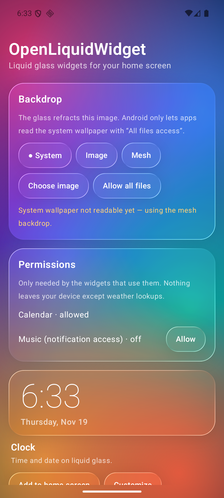
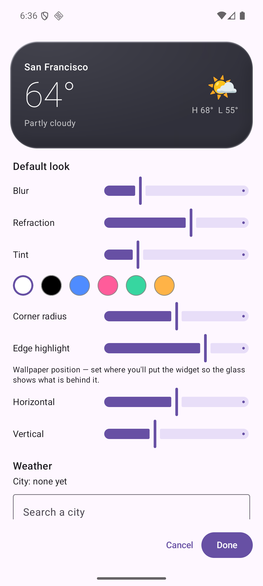
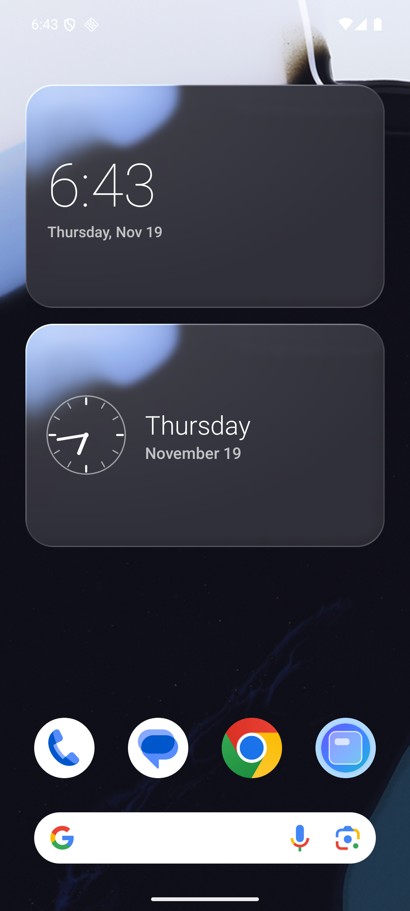

# OpenLiquidWidget

Liquid-glass home-screen widgets for Android 13+, with an in-app gallery and configurator.
The app UI is built with [Kyant0/AndroidLiquidGlass](https://github.com/Kyant0/AndroidLiquidGlass); the home-screen widgets use
an own AGSL shader (blur, rim refraction with slight dispersion, tint, specular edge) because widgets can only show `RemoteViews`.

| Gallery | Configurator | On the home screen |
|---|---|---|
|  |  |  |

## Widgets
- **Clock** – digital time and date
- **Analog clock** – a glass dial with the day and date
- **Weather** – current conditions and today's range, city search via [Open-Meteo](https://open-meteo.com) (no API key, no location permission)
- **System** – battery, memory, storage, network
- **Music** – now playing with prev/play/next (needs notification access; no notification content is read)
- **Calendar** – next three events (needs calendar permission)
- **Notes** – one quick note, edited with a tap

## How the glass works
A home-screen widget cannot run Compose or shaders. For each widget the app crops the wallpaper to the widget's size, renders the
glass off-screen with a `RenderNode` + AGSL `RuntimeShader` (`HardwareRenderer` → `ImageReader`), and pushes the resulting bitmap as
the widget's background. Text colour flips between white and dark based on the brightness of the rendered glass.
Widgets refresh every 15 minutes (WorkManager) and whenever the app is opened.

### Glass quality
Same ladder as OpenLiquidLauncher, in the app's **Glass quality** card: *Minimum* (blur and tint only), *Low* (+ colour boost and rim refraction),
*Current* (+ specular edge and sheen, the default), *High* (+ depth shading), *Maximum* (+ chromatic dispersion and a softer blur).
**Widget resolution** (25%–150%) scales the resolution the home-screen glass is rendered at; the app's own live glass always renders at full resolution.

### Wallpaper caveats
- Android 13+ lets an app read the *system* wallpaper only with **All files access**. Without it the app falls back to a generated mesh
  gradient, or an image you pick (**Backdrop → Image**).
- Android does not tell an app where a widget sits on screen, so each widget has *Horizontal / Vertical* position sliders in its
  configurator to match the crop to where you placed it.

## Build
```
./gradlew :app:assembleDebug
adb install -r app/build/outputs/apk/debug/app-debug.apk
```
Requires JDK 17+, Android SDK 37. `minSdk` is 33 (AGSL `RuntimeShader`); older devices refuse the install.

## License
Apache-2.0, see [LICENSE](LICENSE) and [NOTICE](NOTICE).
